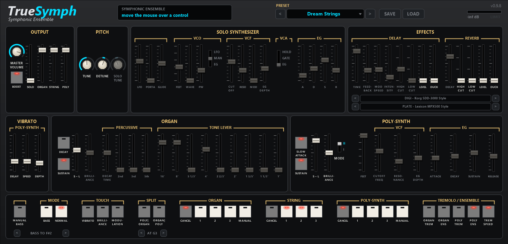

# TrueSymph – Symphonic Ensemble

Privat VST2-instrument (64-bit) för Ableton Live 9.6 på Windows 7 och senare.

Efterliknar Yamaha SK30 (1979–80), byggt efter SK30:s servicemanual.
Alla delar finns med: stråkar, poly-synth, orgel, solosynt, ensemble/tremolo, manual bass och keyboard split. Byggare: **2F Productions** (info@2f.se).

## Status: 0.7.0 – effekter (delay + reverb) och wah-bas

| Funktion | Status |
|---|---|
| Två tongeneratorer (I/II) med heltalsdelare från 1 MHz, fasläsade oktaver | Klar, automatiskt testad |
| Trappstegs-sågtand av fyrkanter (som PG-kortet) | Klar, automatiskt testad |
| STRING 1/2/3 (16'/8'/4') med SK30:s RC-stråkfilter | Klar, automatiskt testad |
| SLOW ATTACK (3/80 ms), SUSTAIN (0,03–1,6 s), sustainpedal | Klar, automatiskt testad |
| MODE I/II och DETUNE (−20…+27 cent på generator II) | Klar, automatiskt testad |
| VIBRATO: DELAY 0–3,2 s, SPEED 5–7 Hz, DEPTH 0–30 cent | Klar, automatiskt testad |
| BRILLIANCE ±12 dB | Klar, automatiskt testad |
| ENSEMBLE: tre BBD-linjer, LFO 0,64 + 6,4 Hz i trappsteg, 120° | Klar, automatiskt testad |
| 7 röster, mjukt röstbyte (inget klick) | Klar, automatiskt testad |
| Etapp 1 i Live 9.6 på Win7 | Testat av användaren: fungerar |
| POLY-SYNTH: CANCEL / 1 / 2 / 3 / MANUAL | Klar, automatiskt testad |
| POLY-SYNTH 1/2/3 med värden ur motståndsnäten på CPC-kortet | Klar, automatiskt testad |
| FEET: 4'/\\, 8'⊓, BP8'/\\, 8'/\\, 16'⊓, 16'/\\ | Klar, automatiskt testad |
| VCF (lågpass/bandpass, resonans Q 0,5–10, EG DEPTH 0–10 oktaver) | Klar, automatiskt testad |
| Envelope ADSR (0,003–3 s / 0,03–30 s / 0–10 / 0,03–30 s) | Klar, automatiskt testad |
| POLY-SYNTH TREMOLO, TREMOLO SPEED (0,64 / 6,4 Hz) | Klar, automatiskt testad |
| Etapp 2 i Live | Användaren testar |
| ORGAN: CANCEL / 1 / 2 / 3 / MANUAL (blandningar enligt CPB-kortet) | Klar, automatiskt testad |
| Nio tone levers 16'–1' med OG1:s tonfilter, lånade (liksvävande) mutationer, brytning i toppen | Klar, automatiskt testad |
| Egen tongenerator (2 MHz), ingen vibrato/detune, som originalet | Klar, automatiskt testad |
| ORGAN DECAY / SUSTAIN (0,03–1,6 s), ORGAN BRILLIANCE ±7 dB | Klar, automatiskt testad |
| PERCUSSIVE 2nd / 3rd / 5th med DECAY TIME | Klar, automatiskt testad |
| ORGAN TREMOLO / ORGAN ENSEMBLE (samma TE-kort, ensemble har prioritet) | Klar, automatiskt testad |
| MASTER VOLUME; STRING VOLUME gäller nu bara stråkarna | Klar, automatiskt testad |
| Etapp 3 i Live | Användaren testar |
| SOLO SYNTHESIZER: VCO (FEET 4'–64', WAVE, PW 50–85 % via LFO/MANUAL/EG) | Klar, automatiskt testad |
| Solo-VCF med tangentföljning, MODULATION, EG DEPTH; VCA HOLD/GATE/EG; ADSR | Klar, automatiskt testad |
| LFO 0,1–100 Hz, PORTAMENTO (0–3 s per tre oktaver), GLIDE (±1 oktav, 70 ms), SOLO TUNE | Klar, automatiskt testad |
| TOUCH VIBRATO / BRILLIANCE / MODULATION (aftertouch eller modulationshjul) | Klar, automatiskt testad |
| MODE NORMAL (högsta tonen), BASS (lägsta tonen), MANUAL BASS (egna bastangenter) | Klar, automatiskt testad |
| KEYBOARD SPLIT POLY-SYNTH▼ORGAN / ORGAN▼POLY-SYNTH, 7 + 7 röster | Klar, automatiskt testad |
| 28 fabriksljud i Lives presetlista | Klar, automatiskt testad |
| Etapp 4 i Live | Användaren testar |
| Eget fönster: kompakt SK30-panel med skjutreglage, SK30-knappar (enligt Fredriks bild) och guldlinjer | Klar, skärmbilder i bygget |
| Display som visar reglaget under musen; grå reglage när de inte används | Klar |
| PRESET: lista vid klick på namnet, pilar, SAVE/LOAD (Dokument\\TrueSymph Presets\\*.tsy) | Klar, automatiskt testad (filformat) |
| Baksida (klicka på loggan): credits och manual på engelska och svenska (ENG / SWE) | Klar |
| Windows 7-kontroll i bygget (inga nyare DLL:er/funktioner) | Klar |
| Etapp 5 i Live | Testat av användaren: fungerar |
| Presetlista vid klick på presetnamnet | **Ej testat ännu** |
| 8 ljud (Rec:) uppmätta ur Fredriks SK30-inspelning, med delay och reverb | Klar |
| EFFECTS: DELAY efter SDD-3000:s servicemanual (0–1023 ms, 17 kHz, HIGH/LOW CUT, MOD 0,1–15 Hz, 2:1) och REVERB med MPX500:s typer, stereo | Klar, automatiskt testad |
| Fönstret 1280 px brett | Klar |

## Installera och testa

1. Gå till repot på GitHub → fliken **Actions** → senaste gröna körningen.
2. Ladda ner **TrueSymph-win64** (en zip-fil) och packa upp `TrueSymph.dll`.
3. Lägg `TrueSymph.dll` i din VST-mapp (samma mapp som TrueSub).
4. Starta Live → **Plug-ins** → dra TrueSymph till ett MIDI-spår.
5. Ta bort eventuell gammal `YamaSK30.dll` ur VST-mappen.

## Fönstret

- **Reglage och rattar:** dra upp/ner, Shift = finjustering, mushjulet = små steg,
  dubbelklick = standardvärde. Displayen överst visar reglaget under musen.
- **Knapparna** fungerar som på SK30: lysdioden lyser när knappen är på. ORGAN och
  POLY-SYNTH väljer ett läge, STRING 1/2/3 kan kombineras (CANCEL stänger av alla),
  SPLIT-knapparna och MANUAL BASS slås av med ett nytt tryck.
- **Grå reglage** används inte just nu (t.ex. tone levers när ORGAN inte står på MANUAL).
- **Loggan** vänder pluginet: baksidan har credits och manualen (ENG / SWE).

## Parametrar (index ändras aldrig)

| # | Namn i Live | SK30-reglage | Område |
|---|---|---|---|
| 0 | Volume | STRING VOLUME | −inf…+6 dB |
| 1 | Str 1 | STRING 1 (16') | av/på |
| 2 | Str 2 | STRING 2 (8') | av/på |
| 3 | Str 3 | STRING 3 (4') | av/på |
| 4 | SlowAtk | SLOW ATTACK | av 3 ms / på 80 ms |
| 5 | Sustain | SUSTAIN-knappen | av/på |
| 6 | SusTime | SUSTAIN-reglaget | 0,03–1,6 s |
| 7 | Mode | MODE I/II | I = en generator, II = båda |
| 8 | Detune | POLY-SYNTH DETUNE | −20…+27 cent |
| 9 | VibDly | VIBRATO DELAY | 0–3,2 s |
| 10 | VibSpd | VIBRATO SPEED | 5–7 Hz |
| 11 | VibDep | VIBRATO DEPTH | 0–30 cent |
| 12 | Brill | BRILLIANCE | −12…+12 dB |
| 13 | Ensembl | POLY-SYNTH ENSEMBLE | av/på |
| 14 | Tune | TUNE | A4 415–466 Hz |
| 15 | PolySel | POLY-SYNTH-knapparna | CANCEL, 1, 2, 3, MANUAL |
| 16 | PolyVol | POLY-SYNTH VOLUME | −inf…+6 dB |
| 17 | Feet | FEET (bara MANUAL) | 4 SAW, 8 SQR, BP8 SAW, 8 SAW, 16 SQR, 16 SAW |
| 18 | Cutoff | CUTOFF FREQ | 20 Hz–20 kHz |
| 19 | Reso | VCF RESONANCE | Q 0,5–10 |
| 20 | EGDepth | EG DEPTH | 0–10 oktaver |
| 21 | Attack | ATTACK TIME | 0,003–3 s |
| 22 | Decay | DECAY TIME | 0,03–30 s |
| 23 | SusLvl | SUSTAIN LEVEL | 0–10 |
| 24 | Release | RELEASE TIME | 0,03–30 s |
| 25 | PolyTrm | POLY-SYNTH TREMOLO | av/på |
| 26 | TrmSpd | TREMOLO SPEED | av 0,64 Hz / på 6,4 Hz |

| 27 | OrgSel | ORGAN-knapparna | CANCEL, 1, 2, 3, MANUAL |
| 28 | OrgVol | ORGAN VOLUME | −inf…+6 dB |
| 29 | OrgDcy | DECAY-knappen | av/på (tonen klingar av medan den hålls) |
| 30 | OrgSus | SUSTAIN-knappen | av/på |
| 31 | OrgTime | DECAY/SUSTAIN-reglaget | 0,03–1,6 s |
| 32 | OrgBril | ORGAN BRILLIANCE | −7…+7 dB |
| 33 | PercDcy | PERCUSSIVE DECAY TIME | kort–lång |
| 34–36 | Perc2, Perc3, Perc5 | PERCUSSIVE 2nd / 3rd / 5th | 0–10 |
| 37–45 | Org16 … Org1 | tone levers 16', 8', 5 1/3', 4', 2 2/3', 2', 1 3/5', 1 1/3', 1' | 0–10 |
| 46 | OrgTrm | ORGAN TREMOLO | av/på |
| 47 | OrgEns | ORGAN ENSEMBLE | av/på |
| 48 | Master | MASTER VOLUME | −inf…+6 dB |

| 49 | SoloVol | SOLO VOLUME | −inf…+6 dB (standard −inf = solosynten tyst) |
| 50 | SMode | MODE | NORMAL, BASS, MAN BASS |
| 51 | LfoSpd | LFO SPEED | 0,1–100 Hz |
| 52 | Porta | PORTAMENTO | 0–3 s (tid för tre oktaver) |
| 53 | Glide | GLIDE DEPTH | −12…+12 halvtoner (mitten = av) |
| 54 | SFeet | VCO FEET | 4', 5 1/3', 8', 16', 32', 64' |
| 55 | SWave | WAVE | sågtand → fyrkant |
| 56 | SPW | PW | 50–85 % |
| 57 | PWSrc | PW-väljaren | LFO, MANUAL, EG |
| 58 | SCutoff | VCF CUTOFF FREQ | 20 Hz–20 kHz |
| 59 | SReso | VCF RESONANCE | Q 0,5–10 |
| 60 | SMod | VCF MODULATION | 0–3 oktaver (LFO) |
| 61 | SEGDep | VCF EG DEPTH | 0–10 oktaver |
| 62 | VCA | VCA-väljaren | HOLD, GATE, EG |
| 63–66 | SAttack, SDecay, SSusLvl, SRelease | EG | som poly-synthen |
| 67–69 | TchVib, TchBri, TchMod | TOUCH VIBRATO / BRILLIANCE / MODULATION | av/på |
| 70 | SoloTun | SOLO TUNE | −500…+700 cent |
| 71 | Split | KEYBOARD SPLIT | OFF, POLY\|ORG, ORG\|POLY |
| 72 | SplitPt | delningspunkt | C1–C5 (Live), standard G2 |
| 73 | BassPt | översta MANUAL BASS-tangent | C1–C5 (Live), standard F#1 |
| 74 | DlyTime | DELAY TIME | 1–1000 ms |
| 75 | DlyFdbk | DELAY FEEDBACK | 0–95 % |
| 76 | DlyMod | DELAY MOD INTENSITY | 1:1 – 2:1 (SDD-3000) |
| 77 | DlyLvl | DELAY LEVEL | av, −36…0 dB |
| 78 | RevDcy | REVERB DECAY | 0,3–8 s |
| 79 | RevLvl | REVERB LEVEL | av, −36…0 dB |
| 80 | DlySpd | DELAY MOD SPEED | 0,1–15 Hz |
| 81 | DlyHiCt | DELAY HIGH CUT | OFF, 8k, 4k, 2k (−6 dB/okt) |
| 82 | DlyLoCt | DELAY LOW CUT | OFF, 125, 250, 500 Hz (−3 dB/okt) |
| 83 | RevType | REVERB TYPE | PLATE, HALL, CHAMBER, ROOM |

Reglagen 18–24 gäller bara i POLY-SYNTH MANUAL, och tone levers bara i ORGAN MANUAL.

**TOUCH:** SK30 känner av hur hårt tangenten trycks ner (en ljussensor). I pluginet
styrs TOUCH av aftertouch från klaviaturen, eller av modulationshjulet (CC1) om
klaviaturen saknar aftertouch.

**MANUAL BASS:** tangenterna upp till BassPt spelar bara solosynten (lägsta tonen
har företräde) och styr inte stråkar, poly-synth eller orgel.

**KEYBOARD SPLIT:** POLY|ORG = stråkar och poly-synth under delningspunkten, orgel
över. ORG|POLY = tvärtom. Varje halva har 7 röster. POLY-SYNTH 1/2/3 har egna fasta värden.
ENSEMBLE och TREMOLO gäller både stråkar och poly-synth, precis som på SK30.

## Hur ljudet är byggt (från servicemanualen)

- **Tongenerering (PG-kortet):** två YM70400 delar ner en masterklocka på 1 MHz.
  Toppoktaven (C7–B7) får heltalsdelare, och alla lägre oktaver är exakta
  halveringar. Därför är alla toner fasläsade mot varandra, och stämningen avviker
  högst 1,4 cent från liksvävande, precis som i chippet. Tonerna löper fritt
  (ingen fasåterställning vid tangenttryck).
- **Sågtand i trappsteg:** /\8 = 0,69·fyrkant 8' + 0,47·fyrkant 4',
  /\16 = 0,69·fyrkant 16' + 0,47·/\8, /\4 = fyrkant 4' (motstånden 68k/100k mot 47k).
- **Stråkfilter:** passiva RC-stegar, exakt modellerade:
  16': 12k/27n + 12k/(8,2k)/27n. 8' och 4': 12k/18n + 12k/(5,6k)/18n.
- **Keyer:** varje röst har en envelope (SLOW ATTACK och SUSTAIN), samma för
  stråkar och poly-synth.
- **Vibrato:** modulerar masterklockan (alla toner), med fördröjning som tonar in.
- **Poly-synth (CPC-kortet):** samma tangenter och keyer som stråkarna, men genom
  ett gemensamt spänningsstyrt filter (IG00156, lågpass eller bandpass) med egen
  envelope (IG00151). Ingen VCA: volymen kommer från keyern. Envelopen startar om
  vid varje ny tangent. POLY-SYNTH 1/2/3 är fasta motståndsnät (läge = 10k/(R+10k)):

  | | CUTOFF | RESONANCE | EG DEPTH | ATTACK | DECAY | SUSTAIN | RELEASE |
  |---|---|---|---|---|---|---|---|
  | 1 | 18k | 2,2k | 27k | 18k | 15k | 56k | 3,3k |
  | 2 | 56k | 1,2k | 10k | 12k | 6,8k | 8,2k | 5,6k |
  | 3 | 15k | 2,2k | 22k | 6,8k | 18k | 27k | 4,7k |

  Alla tre använder 16'-sågtanden.
- **Orgel (OG1 + CPB):** egen tongenerator med masterklocka 2 MHz (ingen vibrato eller
  detune, precis som originalet). Nio fotlägen; mutationerna lånas från andra tangenter
  och är därför liksvävande. Högsta fotlägena bryts tillbaka i toppoktaven (C8–B8).
  Varje fotläge har OG1:s tonfilter (4,7k / 1,5k-shunt / Sallen-Key 33k), som gör
  fyrkanterna mjuka i diskanten. ORGAN 1 = 16' 8' 5 1/3', ORGAN 2 = 16' 8' 4' 2' 1',
  ORGAN 3 = alla nio. Slagverket (2nd = 4', 3rd = 2 2/3', 5th = 1 3/5') har en
  gemensam envelope (15 µF genom 2,7k + DECAY TIME) som startar om vid varje ny tangent.
- **Solosynt (CPB 7/9):** en analog VCO (lite långsam drift) med fotlägen 4'–64',
  sågtand som blandas mot fyrkant, PW 50–85 %. VCF med tangentföljning (KV), samma
  filtertyp som poly-synthen. Högsta tonen har företräde (NORMAL), lägsta i BASS och
  MANUAL BASS. Ny tangent ger ny attack, tillbaka till en hållen ton ger legato.
  Solosynten har egen utgång och går inte genom ensemble/tremolo.
- **Tremolo (TE-kortet):** när ENSEMBLE är av och TREMOLO på styr klockchippet
  både volymen (VCA) och delay-chippen med en LFO på 0,64 eller 6,4 Hz.
- **Ensemble (TE-kortet):** tre MN3009 parallellt. Varje linje svajas av en
  långsam (0,64 Hz) och en snabb (6,4 Hz) trappstegs-triangel från YM63300,
  120° förskjutna. Lågpass före (ca 6,6 kHz) och efter (ca 5,4 kHz). Mono, som originalet.

## Konventioner

- **Tonnamn:** Abletons konvention, MIDI 60 = C3.
- **Mono:** SK30 är mono, därför är vänster och höger identiska så länge DELAY och REVERB är av.
- **Inte anslagskänslig:** som SK30:s stråkdel.
- **Nivå:** standardljudet ger ca −16 dBFS RMS med ett fyrtonsackord.

## Namnet

Pluginet hette först YamaSK30 och heter nu TrueSymph. Det har samma interna ID
som förut, så Live-projekt som sparats med YamaSK30 öppnas med TrueSymph.
Ta bort den gamla `YamaSK30.dll` ur VST-mappen så att pluginet inte syns två gånger.
TrueSymph har ingen koppling till Yamaha.
